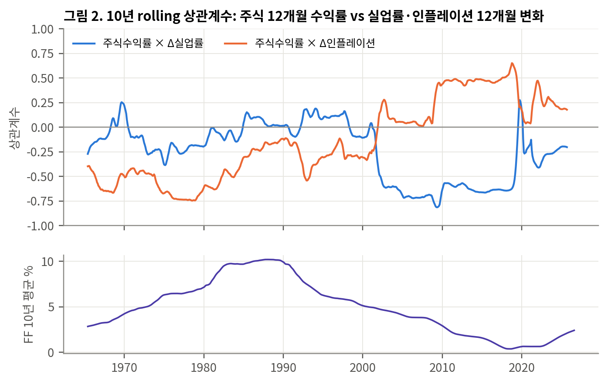
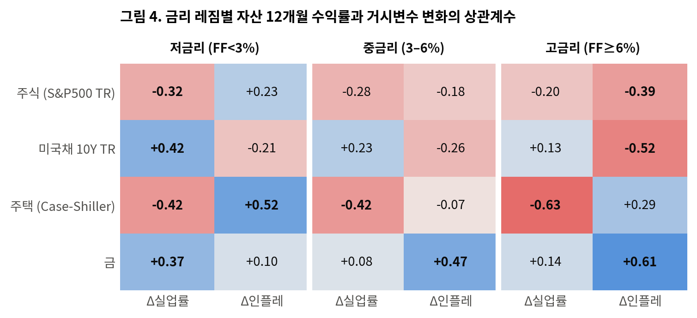

# 금리가 정하는 '고통'의 가격

**Misery Index 분해로 본 실업률·인플레이션과 자산가격의 레짐 의존적 관계 — 미국 1955–2026 월간 데이터 실증분석**

📄 [리서치 보고서 PDF (10쪽)](report/misery-index-regime-research.pdf)

## 요약

Misery Index(실업률 + 인플레이션)는 두 구성요소에 같은 가중치를 주지만, 자산시장이 두 변수에 반응하는 방식은 **금리 수준에 따라 달라진다.**

- **저금리(연방기금금리 3% 미만)**: 주가는 실업률에 반응한다. 인플레이션은 위험요인이 아니다.
- **고금리(6% 이상)**: 주가는 인플레이션에 반응한다. 인플레이션의 부호가 저금리 때와 반대로 뒤집힌다.
- **동일가중 Misery Index**는 저금리 구간에서 두 효과가 상쇄되어 주가 설명력이 사라진다(상관 −0.05). 고금리 구간에서는 −0.50.



### 금리 레짐별 상관계수 (자산 12개월 수익률 vs 거시변수 12개월 변화)



| 자산 | 저금리에서 지배 변수 | 고금리에서 지배 변수 |
|---|---|---|
| 주식 (S&P500 TR) | 실업률 (ρ = −0.32) | 인플레이션 (ρ = −0.39, t = −2.98) |
| 미국채 10Y TR | 실업률 (β = +0.40, t = 4.44) | 인플레이션 (β = −0.52, t = −3.19) |
| 금 | 실업률 (β = +0.54) | 인플레이션 (β = +0.70, R² = 0.48) |
| 주택 (Case-Shiller) | 레짐과 무관하게 실업률에 음(−)의 반응 | |

β는 표준화 다중회귀 계수, t는 Newey-West(시차 12) 기준.

## 방법

- **변수**: 자산 12개월 로그수익률, 실업률 12개월 변화(ΔU), CPI 인플레이션율 12개월 변화(Δπ)
- **레짐**: 수익률 측정 구간이 *시작되는 시점*의 연방기금금리로 분류 (저 <3% / 중 3–6% / 고 ≥6%) — look-ahead 방지
- **추정**: 레짐별 표준화 회귀 `z(R) = α + β_U·z(ΔU) + β_π·z(Δπ)`, 중첩 수익률의 자기상관은 Newey-West로 보정 (numpy로 직접 구현)
- **강건성**: 임계값 1–9% 스윕, 10년물 금리 기준 레짐, 실질수익률, 코로나 구간 제외, 순위상관, 비중첩 연간 표본

## 한계

- 동행 관계 분석이며 수익률 예측 모델이 아니다.
- 저금리 구간에서 인플레이션의 양(+)의 효과는 순위상관 기준 0에 가깝다. "호재"가 아니라 "위험요인이 아니다"로 해석한다.
- 고금리 표본은 1970–80년대에 집중되어 있고, 주택의 고금리 표본은 63개월로 작다.

## 폴더 구조

```
build_data.py   원자료 병합 → data/dataset.csv (Misery Index, 주식·채권 총수익지수)
analysis.py     레짐별 회귀분석 (Newey-West)
robust.py       강건성 검증
figs.py         그림 1–7 생성 → figures/, 결과표 → data/results.json
data/           dataset.csv (가공된 월간 데이터셋), results.json
figures/        보고서 그림
report/         보고서 PDF
```

## 실행

```bash
pip install -r requirements.txt
python analysis.py    # 레짐별 회귀 결과 출력
python robust.py      # 강건성 검증 결과 출력
python figs.py        # 그림 재생성
```

`data/dataset.csv`가 포함되어 있어 위 세 스크립트는 바로 실행된다.
원자료부터 다시 만들려면 아래 저장소를 `raw/` 폴더에 clone한 뒤 `python build_data.py`를 실행한다.

```bash
mkdir raw && cd raw
git clone --depth 1 https://github.com/datasets/s-and-p-500.git
git clone --depth 1 https://github.com/datasets/bond-yields-us-10y.git
git clone --depth 1 https://github.com/datasets/gold-prices.git
git clone --depth 1 https://github.com/datasets/house-prices-us.git
git clone --depth 1 https://github.com/theodorewright11/macro_eco_dashboard.git
```

## 데이터 출처

| 변수 | 출처 |
|---|---|
| 실업률(UNRATE), CPI(CPIAUCSL), 연방기금금리(FEDFUNDS), 10Y 금리(DGS10), 경기침체(USREC) | FRED (공개 GitHub 사본 경유) |
| S&P500 지수·배당 | Robert Shiller 데이터셋 |
| 금 가격, Case-Shiller 전국주택가격지수, 10Y 금리(1953–61) | datahub `datasets` |

10년 국채 총수익지수는 수익률로부터 합성했다(매월 액면가 매입 → 익월 금리로 재평가 + 이자수익). 금은 1973년 이후, 주택은 1988년 이후 표본만 사용.
